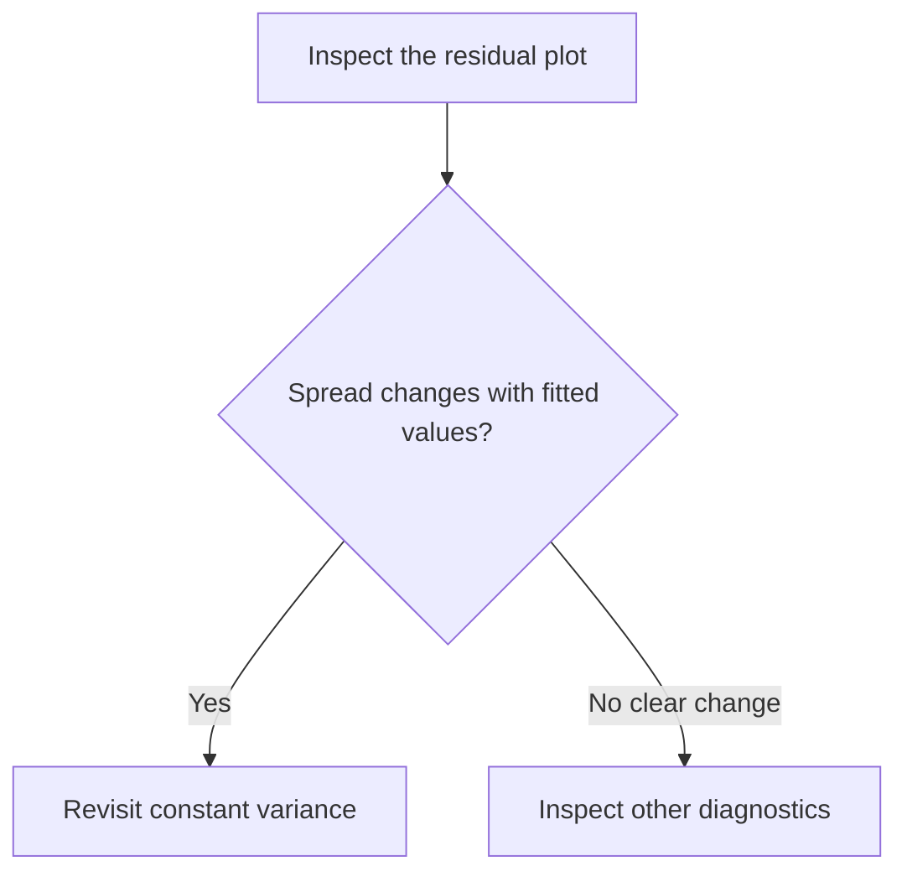

# Obsidian 学习资料整理工具 · 第一版部署指南

目标是让两件事都变得容易：上课之后知道新资料该放哪里，几个月后从一个知识点能找回当时的解释、原始页码和做错的题。建议先用一门课的一周资料跑通。下文以 macOS 为主，空白课程也可以用 Windows 的 File Explorer 复制。浏览笔记、PDF 和练习无需运行任何命令。

**包内两个起点。** 想看成品，打开 `Home.md` 进入 `DEMO101`。想开始自己的课，直接使用 `Blueprints/Blank-Course/`。DEMO101 是原创教学示例，课程内容和编号仅用于演示。指南中的路径相对于 `StudyVault/`，除非特别说明。

## 1 · 打开并配置 vault

1. 从官网下载桌面版 Obsidian。下载第一版 ZIP，解压到普通本地文件夹。Mac 上可在个人主目录建 `Study/`，最终位置为 `~/Study/StudyVault/`。如果决定用 iCloud 同步，直接使用第 8 节 B 的位置。[下载 Obsidian](https://obsidian.md/download)
2. 打开 Obsidian 的 vault switcher，点 **Open folder as vault**，选择同时包含 `Home.md`、`Courses/`、`Templates/` 的 **StudyVault**。每个课程就是这个 vault 下的一个文件夹。首次打开先从左侧 File explorer 点 **Home**。用 **Quick switcher**（Mac 上 ⌘O）也能找到 Home。
3. 在 **Settings → Core plugins** 确认 **Templates、Page preview、Backlinks、Outline、Search** 已打开。可同时使用 **Graph view** 查看知识点的 local graph，使用 **File recovery** 查看当前设备的近期笔记快照。第一版的课程浏览、练习与多媒体示例均可在关闭 Community plugins 的状态下使用。
4. 在 **Settings → Templates → Template folder location** 检查为 `Templates`。在 **Files and links** 打开 **Automatically update internal links**，**New link format** 选 **Absolute path in vault**，启用 **Use Wikilinks**。在已有课程中移动文件时，用 Obsidian 的 File explorer 操作，方便它更新链接。
5. 同一页中，把 **Default location for new attachments** 设为 **In subfolder under current folder**，子目录名填 `_assets`。随笔粘贴的一张截图进入该笔记旁的 `_assets/`。整班复用的 slides、视频和手写 PDF 则按第 4 节放进课程的 Materials。包内已附这些初始设置。手动合入已有 vault 时可通过菜单逐项设置，以保留你原来的个性化配置。[Obsidian 附件设置](https://obsidian.md/help/attachments) · [Core Templates](https://obsidian.md/help/plugins/templates)
6. 打开 DEMO101 的 Course，按目录进入 **Constant variance**。在桌面 **Reading view** 中把鼠标移到相关知识点链接上。在 **Editing view** 中，Mac 按住 ⌘ 再悬浮，Windows/Linux 按住 Ctrl。手机直接点链接或读笔记内已经展开的引用。检查 PDF、公式和折叠答案时，可先切到 Reading view。[Page preview](https://obsidian.md/help/plugins/page-preview)

**与现有 Git repo 的关系。** 如果你想在现有 clone 中维护这个工具，将本包中的初始 `StudyVault/` 放到 repo 下，比如 `starter/StudyVault/`，在那里维护 blank blueprint、Templates、Tools 和 DEMO101。把 `starter/StudyVault/` **复制一份**到上述个人学习位置后，再导入真实课程材料。今后工具调整用 Git 做 diff、commit 和 review；日常课程内容用第 8 节的方案同步。升级时只复制新版本要更新的模板或脚本，自定义过的模板先比对。这样既能在 repo 里改工具，也能决定哪些笔记和课件进入 remote。

## 2 · 看懂单门课的结构

| 想解决的问题 | 存放位置 | 谁负责导航 |
|---|---|---|
| 这门课学了什么？ | `Courses/<课程ID>/Course.md` | 按 syllabus、chapter 或 week 指向各个 Module 首页 |
| 这一章分成哪些知识点？ | `Modules/<序号-主题>/Module.md` | 有顺序的知识点清单，必要时写 prerequisite |
| 这个知识点怎么理解？ | 与 Module.md 同目录的一份 Concept note | 连续解释、定义、例子、页码、相关概念和题目 |
| 老师给的东西在哪里？ | `Materials/` 按介质收原件，`Materials/Sources/` 放来源笔记 | `Materials/Materials.md` 按 lecture、week 或来源查原件 |
| 哪道题需要再做？ | `Practice/Worksheets/`、`Assignments/`、`Exams/`（三类均在 Practice 下） | `Practice/Practice.md` 链到每份练习，并检索待复习题 |
| 可运行演示放哪里？ | `Labs/<实验名>/` | Lab.md 说明学习问题、启动方式、交互与静态替代 |

**教学顺序只维护一份。** 比如 Week 3、Week 4 都讲 Linear Regression，就在 Course 页两周的条目下指向同一个 Module，Week 4 可以直接指向其中某个 Concept。以后按 week 回顾时读 Course，按概念回顾时从 Module 进入。想把当前课的概念与另一门课关联，可在正文添加跨课程链接，保留各课程各自的符号、例题和顺序。

> 一个可操作的拆分标准：如果 Worksheet 的一道题、另一章的证明和一页 slide 都会用同一个定义，就给这个定义独立的 Concept note。如果只是某个例子的一步计算，留在例子附近，阅读会更连续。

## 3 · 建立第一门真实课程

**GUI 路径。** 关闭该 vault 或先回到 vault switcher。在 Finder / File Explorer 中，复制 `StudyVault/Blueprints/Blank-Course/` 到 `StudyVault/Courses/`，把复制出来的文件夹命名为本学期课程 ID，例如 `STA302-2026F`。重新打开 vault。

1. 打开 `Courses/STA302-2026F/Course.md`，填写课程标题、学期和 syllabus 顺序。将课程笔记的 `course` property 填为 `STA302-2026F`；需要按该 property 过滤其他笔记时，也填入相同值。空白课程内部已有的相对链接在整目录复制后仍指向新课。
2. 在 vault 的 `Home.md` 增加一行 `- [[Courses/STA302-2026F/Course|STA302 · Regression Analysis]]`。点击它，确认路径以 `Courses/STA302-2026F/` 开头。
3. 打开 `Modules/01-Module/Module.md` 及同目录的 `Concept-01.md`，先用真实大纲中的第一个 Module 和第一个知识点替换正文标题。若要修改文件名或目录名，在 Obsidian 中操作，再从课程目录走一遍。编号只控制阅读顺序，文件名可以保留原样。
4. 新增第二个 Module 时，在 `Modules/` 建目录，例如 `02-Diagnostics/`，在里面新建 `Module.md`。Mac 按 ⌘P（Windows/Linux 按 Ctrl+P），运行 **Templates: Insert template** 选 **Module**。在课程目录输入两个左方括号，选择刚创建的完整路径。新建空 Concept 时同样选 **Concept**，把它添加到 Module 的清单。新链接可用 `|标题` 让读者看到概念名。
5. 用 blank 中的 Worksheet 和 Materials 首页试录一份题、一个原件，见第 4、6 节。从 Home → 你的课程往下点，确保没有走到 DEMO101 或 Blueprints。

**可选的命令行路径。** 安装 Python 3 后，在 Terminal 中进入 **StudyVault**（可输入 `cd `，从 Finder 把文件夹拖进 Terminal，再回车），运行：

```bash
python3 Tools/new_course.py "STA302-2026F" --title "Regression Analysis"
```

Windows 有 Python Launcher 时可将开头换为 `py -3`。脚本复制同一份 blueprint、填写课程标识并打印一条首页链接；把这一条贴到 Home.md 即可。课程 ID 重名时脚本会停止。第二门课只要更换 ID 和标题，例如 `EAS151-2026F` 和 `Elementary Japanese`。

## 4 · 把一周的原始资料变成可回顾的笔记

以「两份 lecture slides、一份手写 PDF、一个录播链接，加一份 worksheet」为例：

1. **先收齐。** 未分类的下载暂放 `Materials/Inbox/`。有原课程网站的，先在来源笔记记下 URL、lecture / week。手写 PDF 保留原页序。
2. **把原件归位。** Slides 放 `Slides/`，手写笔记放 `Handwritten/`，worksheet 原题和老师发的说明放 `Handouts/`，课程共用图片放 `Images/`，本地录像放 `Video/`，音频放 `Audio/`，其余放 `Other/`。从操作系统把文件复制到最终目录，再从 Obsidian 输入链接。已有原件可从 vault 内的 File explorer 拖进笔记或用链接选择器引用，避免从 Downloads 重复拖入。一份原件可以被多个知识点引用。
3. **一份来源、若干定位。** 在 `Materials/Sources/` 新建例如 `W03-L01.md`，插入 **Source** 模板。记原始标题、来源、文件链接和有意义的定位，例如「PDF p.7 是定义，p.12 是反例」或「录播 14:43 开始推导」。纯网络资料只要 URL 和时间戳。把来源笔记加到 `Materials.md`。一份 slides 涵盖三个 Module，仍只记一份来源。
4. **按理解拆解。** 在相应 Concept 中写自己的解释，在恰好需要的那句话后嵌入原件的具体页或图片。手写资料中公式难搜时，把关键词或公式手动录入 Concept，旁边留页码以便核对。原生全文 Search 主要搜索笔记和 Canvas 的内容。[Obsidian Search](https://obsidian.md/help/plugins/search)
5. **把题接回知识点。** 练习原件留在 Materials，做题过程写入 Practice 的一份笔记。题目下指向相应 Concept，再从 Concept 链回一两道代表题。点击右侧 **Backlinks** 也能看到哪些页面在引用当前概念。

| 收到的资料 | 写笔记时怎么用 |
|---|---|
| 手写 PDF / PDF slides | `![[路径/文件.pdf#page=7&height=360]]` 在正文显示阅读器，初始定位到 PDF 第 7 页。文件页序与 slide 印刷编号可能不同。点开原件可继续翻页。 |
| PowerPoint / Keynote | 原文件保留用于编辑，同时从原软件导出 PDF 做内嵌版本。原演示含动画时，可另录短 MP4 并附在相关段落。 |
| 单张图 / 音频 | `![[路径/图.png\|520]]` 或 `![[路径/录音.m4a]]`。截图只用于一个 Module 时可直接粘贴到该页。 |
| 本地视频 | `![[路径/片段.mp4]]`。包内 V01 同时展示原创本地 MP4、静态图和一个网页播放器。跨设备播放还取决于该设备支持的 codec。 |
| YouTube | ``。下面保留原站链接和希望复习的时刻。 |
| 学校录播、外部网页 | 若平台提供 **Share → Embed**，把官方 embed URL 放到 iframe 的 src。若需要登录或站方限制 iframe，保留可点击的课程平台链接、时间戳和文字摘要。先在第二台设备验证账号能否播放。 |

官方语法与支持格式见 [Embed files](https://obsidian.md/help/embeds)、[Embed web pages](https://obsidian.md/help/embed-web-pages) 和 [Accepted file formats](https://obsidian.md/help/file-formats)。

## 5 · 把 Concept 写成一段可以顺着读下去的笔记

在每页最上方先写「它解释哪个问题」，接下来把定义、推导和例子按思路串起来。相关概念很短且读者必须马上看到时，在原地嵌入；只是可能用到的背景，放一个有意义的链接。比如「Residual 的散布应该大致稳定」后面可以接一个公式，再接一张原始图，图下问「如果右侧变宽，对应哪个 assumption？」。

| 表现方式 | 写法或操作 |
|---|---|
| 跳转、悬浮预览 | 输入 `[[` 搜索 Concept，可选择页、heading（`#`）或 block（`#^`）；Reading view 桌面悬浮。把公式放在单独 heading 下，链接写成「variance 公式」，预览时有上下文。 |
| 把另一页的一段排进这段正文 | 给目标段落末尾加 ` ^variance-definition`，另页通过 `![[路径/Concept#^variance-definition]]` 引入。若是一组公式、文字与图片，在它们前面设一个 heading，用 `![[路径/Concept#标题]]` 引入整节，修改原文会更新引用。 |
| 数学与折叠推导 | 一行内用 `$e_i=y_i-\hat y_i$`。独立公式前后各放一行 `$$`。较长推导用 `> [!example]- 展开推导`，后续段落都以 `>` 开头。打开右侧 **Outline** 可看当前笔记标题层级。 |
| 结构图与科学图 | 算法依赖或决策流程用一个 `mermaid` fenced code block。需要精确刻度的 regression 或 probability plot 用 Python / R 生成 PNG 或 SVG，再按文件嵌入。 |
| 同屏阅读 | 右键桌面 tab → **Split right** 或 **Split down**。一侧开视频或长 PDF，另一侧开 Concept。需要一直看到同一来源时，右键该 tab → **Pin**。 |

Obsidian 会把下面的 Mermaid code block 渲染成图。在 Editing view 查看源文本，即可按自己的课程内容修改。也可在核心设置中开启 heading folding，让长页面只展开当前节。参见 [Internal links](https://obsidian.md/help/links)、[Advanced formatting syntax](https://obsidian.md/help/advanced-syntax)、[Callouts](https://obsidian.md/help/callouts) 和 [Tabs](https://obsidian.md/help/tabs)。



## 6 · 一份 worksheet 一页，每道题都能单独回看

1. 从该课的 `Practice/Practice.md` 进入对应的 worksheet。新 set 就在 `Practice/Worksheets/` 新建一份笔记，例如 `Worksheet-02.md`，插入 **Practice-Set** 模板。Assignment 和 exam 同法存入各自目录。把新 set 的链接加入 Practice 首页。原题 PDF 如有，正文开头引用一次。
2. 把光标放在两题之间或文末，通过 **Templates: Insert template → Question** 插入一道题。只改题号、题干、知识点与 solution。每一题用唯一且稳定的 heading（如 `## Q02`）；这样题目换顺序，已建立的链接仍能指向这道题。
3. 答案使用默认折叠的 callout；从 Reading view 读题，完成后点标题核对。多行答案中，空行也带 `>`，避免后面的推导跑到折叠框外。错题状态写在对应题下面，一份包含 20 题的 worksheet 可以只有 Q07 待重做。
4. 将模板中的例子改成你实际的知识点。下面是一道题的最小写法，更长的 proof、评分意见或第二种解法都可以按需追加。

```markdown
## Q02

若 residual plot 的散布随 fitted values 增大，首先检查哪条 assumption？

知识点：[[Courses/DEMO101/Modules/01-Linear-Regression/03-Constant-Variance|Constant variance]]

> [!success]- Solution
> 检查 constant variance。把不同 fitted values 区域的垂直散布做比较。

```

回顾时，直接链接到具体题，例如 `[[Courses/DEMO101/Practice/Worksheets/Worksheet-01#Q02|Worksheet 1 · Q2]]`。若给老师批改前、批改后各留一种解法，可以在同一题下放两个不同的折叠块，题干仍只写一次。

**错题登记与重做。** 示例 Worksheet 01 的 Q02 下面已经有一行 `Q02 #review/missed`。做错别的题时，在该题下加对应的一行。重做正确后改成 `Q02 #review/resolved`，以后既能看当前待重做题，也能查历史。Mac 按 ⌘⇧F，在 Search 输入下面一行（换成自己的课程 ID）。Obsidian 按文件归组，展开匹配并点带题号的行即可定位。若在核对某一张卷，可再加 `file:"Worksheet-01"`。示例 Practice 首页也有内嵌搜索。

```text
path:"Courses/DEMO101/Practice/" tag:#review/missed
```

## 7 · 使用 simulation，以及以后怎么增加交互

**直接试一次。** 从 Demo 课程进入 Constant variance → Variance lab。桌面端可在 Finder 打开该实验目录，双击 `index.html`，直接拖动 **Spread growth κ**。无需安装 Python，页面也没有外部 JavaScript 或字体依赖。看左侧 observations 围绕 fitted line 散开的方式，以及右侧 residuals 在同一时间如何变化。悬浮某个点时，两图会标出同一个 observation。

**要把它留在笔记里操作**，在 `StudyVault/` 下打开 Terminal，执行：

```bash
cd "Courses/DEMO101/Labs/variance"
python3 -m http.server 8765 --bind 127.0.0.1
```

1. 保持 Terminal 窗口打开，在浏览器输入 `http://127.0.0.1:8765/index.html`。看见两张图后，在 Obsidian 打开 Lab.md 的 Reading view。里面已写好 iframe；也可以回到 Constant variance 那一页，展开互动区直接观察。
2. 试着将 κ 从 0 调到 2.4，然后点击 **Animate**。模型对两张图使用同一组模拟扰动；每次改变 κ，会重新拟合 OLS 并同时更新 observations 与 residuals。这个同步关系是实验本身实现的。另开一页 YouTube 后，视频有独立的时间轴。
3. 如果浏览器显示目录列表或 404，检查启动位置是否为仅放这个实验的 `variance/`。端口已占用可改成 8766，并同步修改 Lab.md 的 iframe 和浏览器链接。当前窗口空白时先试浏览器或重开笔记。用完按 Ctrl+C 停止 server。
4. 手机上也能直接读静态结果和模型说明。`127.0.0.1` 在手机上指向手机本身。若要在所有设备上操作同一个模拟，可将这个自有 HTML 放到支持 iframe 的 HTTPS 静态站点，将 Lab.md 的 URL 换为实际地址，并用手机试一次。学校录播保持使用各自平台的登录流程。

**下一次扩展的落点。** 新实验复制 `Labs/variance/` 的结构到独立目录，每个实验有自己的 `Lab.md`、入口和一张可离线阅读的图。多个视图需联动时，共用同一个参数状态和同一批数据；这个示例可从 `estimate(kappa)` 扩展第三个视图。多个可独立运行的 Python / R 程序则需要单独的本地进程或服务来协调、输出状态；普通 Markdown code block 负责展示代码。视频要自动跟着模拟跳转时，还需播放器提供时间控制 API，并在实验中定义时间与参数的对应关系。如果新增的只是语法例句、音频或 proof，直接扩展该课的 Concept 内容即可，无需碰别课的设置。

## 8 · 多端同步：一次只选一条路线

### A · Mac、Windows、手机混用：Obsidian Sync

适合需要多个平台、愿意使用付费订阅的情况。主设备选有完整课程材料的电脑。使用 `~/Study/StudyVault/` 等普通本地位置，并确保该目录由单一双向同步服务管理。

1. 在主设备 **Settings → General → Account** 登录。启用 **Core plugins → Sync**。在 **Settings → Sync → Remote vault → Choose → Create new vault** 创建 remote vault，选择地区，记录加密密码，点击 **Create → Connect**。加密密码和 Obsidian 账号密码是两个项目。
2. 首次开始前，在 **Settings → Sync → Selective sync** 检查 Images、Audio、Videos、PDFs。要把 HTML、Python、PPTX 或其他原件也带到第二台设备，启用 **Sync all other types**。在 **Vault configuration sync** 按需勾选 Main settings、Active core plugin list、Core plugin settings，以便带过去 Templates 等设置。更改设置后按官方步骤重启，再 **Start syncing / Resume**。
3. 等主设备的 Sync log 出现 **Fully synced**。在第二台设备打开 vault switcher，选 **Open vault from Obsidian Sync / Setup Obsidian Sync**，登录，连接已有 remote vault，并让它创建新的本地副本。逐设备检查 Selective sync 和配置同步设置。待下载完成后打开 Home。空目录若没有跟过去，在首次使用时新建同名目录即可。
4. 上传批量课件前，先比较文件大小与当前 plan。截至 2026-11-14，官方表列 Standard 单文件上限 **5 MB**、Plus **200 MB**。连手写 PDF 也可能超限。大视频可放在你有权使用、各设备均能访问的位置，把稳定链接、时间戳和摘要放入 Source note；另把你持有的原件纳入 backup。只存平台链接时，后续可访问性取决于原提供方。
5. 双向验收：Mac 在测试笔记加一行，手机读到后再回写一行，Mac 应能读到；接着在手机打开 PDF 指定页、PNG 和本地 MP4。最后在第二台电脑确认实验 HTML 已下载。两个设备若离线改到了同一页，先保留两份内容，通过 Sync log / version history 核对并合并。

[官方首次设置](https://obsidian.md/help/sync/setup) · [Selective sync 与逐设备设置](https://obsidian.md/help/sync/settings) · [容量与单文件上限](https://obsidian.md/help/sync/plans)

### B · 主要是 Mac、iPad 和 iPhone：iCloud Drive

1. 所有设备使用同一个 Apple Account 并启用 iCloud Drive，允许 Obsidian 使用 iCloud。先在 iPhone/iPad 的 Obsidian 新建名为 StudyVault 的 vault，打开 **Store in iCloud**；这样会建立官方 Obsidian 容器。
2. 等 Mac 的 iCloud Drive 出现带 Obsidian app 图标的 `Obsidian/StudyVault/`。关闭两端的这个 vault，将解压所得 `StudyVault/` **里面的内容**复制进去，最终层级应是 `iCloud Drive/Obsidian/StudyVault/Home.md`。首次设置可在 Finder 按 ⌘⇧. 显示 `.obsidian/`。若手机刚建立的是空白 vault，可采用包内这份设置。已有笔记或自定义配置则照第 1 节手动配置。
3. 在 Mac 用 **Open folder as vault** 打开该目录。macOS 15 或更高版本可在 Finder 对 Obsidian 目录选择 **Keep Downloaded**，方便离线和备份。手机打开刚创建的同名 vault，等待同步。此方案保持 Obsidian Sync 关闭。若计划经常在 Windows、Android 编辑，可优先评估路线 A。
4. 按路线 A 的第 5 步做双向与附件检查，并在飞行模式下试读一张已下载的图或 PDF。两个设备同时离线时尽量编辑不同笔记，回到网络后再继续另一端的工作。

[Obsidian 的 iCloud 路径、设备支持与离线设置](https://obsidian.md/help/sync-notes)

## 9 · 备份和恢复演练

同步会把误删传播到其他设备。选一台留有**完整且已下载**课程材料的电脑，给它另设带历史版本的备份。范围包括整个 `StudyVault/`（含 `.obsidian/`、Templates、Blueprints、Tools、PDF、图片、录像和 Labs）；若某些大视频另存于 vault 外，也要把那一处纳入备份。

1. **Mac 自动备份。** 连接外置备份盘，在 **System Settings → General → Time Machine → Add Backup Disk** 选择准备用作备份的磁盘，按需启用加密并保存密码。在 **Options** 中确认课程所在位置未被排除。选择 **Back Up Now**，等到显示本次完成时间。若系统要求清空已有资料的磁盘，请改选专用磁盘。首次完成后，让磁盘定期连接以生成后续版本。
2. **保留一份可移走的学期快照。** 大批归档、模板升级前，或每学期结束时，关闭 vault，使用 Finder 对完整 StudyVault 文件夹选择 **Compress**。将带日期的 ZIP 放到另一个设备或受控的备份位置。解压检查它既有 `Home.md` 又有 `.obsidian/` 和真实附件。Git 中的 starter 无法还原当时未放入 Git 的个人资料。
3. **实际演练一次。** 在本地建立一个与同步目录分开的 `Restore-Test/`，从课程复制一篇笔记和一个 PDF 进去，运行一次 Time Machine 备份。仅删除这两个测试副本，进入 Finder 的 Restore-Test 文件夹，打开 **Browse Time Machine Backups**，选删除前的时间点，再 **Restore**。确认笔记和 PDF 都能打开。这样可以验证恢复动作，不会影响正在同步的课程。
4. **再验证整个课程能用。** 将学期快照解压到另一个普通本地目录，先断网，再用 Obsidian 打开解压的 vault，检查该副本的 Sync 处于关闭或已断开状态。检查 Course → Module → Concept → 题目的链接、PDF 指定页、视频以及 Templates 目录。真正需要恢复时先暂停正在写入该 vault 的同步，保留故障现场的一份副本，选好版本后再将确认无误的文件放回。
5. **只误改了一页。** 如果启用了 **Settings → File recovery**，可先查看该设备近期的笔记文本快照。找回整个课程、媒体或较旧版本时，用上面的独立备份。

[Obsidian Backup](https://obsidian.md/help/backup) · [Apple Time Machine 设置](https://support.apple.com/en-us/104984) · [Apple 文件恢复](https://support.apple.com/guide/mac-help/mh11422/mac)

## 10 · 试点、验收与模板更新

| 自测任务 | 通过的可见结果 |
|---|---|
| 从 syllabus 找一条 assumption | Course → Module → Concept；链接始终留在指定课程 |
| 理解另一个 Concept 的公式 | 悬浮看定义，或在正文直接看到跨页引用；改原定义后引用随之更新 |
| 同一讲义被不同知识点使用 | 两页都能打开同一 PDF，各自定位到选定页；对应目录仅存一个原件 |
| 从错题回顾到原理 | 在一份 worksheet 中仅标 Q02，搜索能定位该行；改成 resolved 后从待办结果移除，原题和解答保留 |
| 在没有网的地方复习 | Concept、折叠答案、已下载的 PDF/图片/MP4 可读，实验有截图和文字解释 |
| 比较同一参数下的两个模型视图 | 打开 Variance lab，拖动 κ 两侧同步更新，悬浮同一个 observation 两侧都高亮 |
| 新建第二门课 | 两课可以都有 `Course.md`、`Module.md`、`Worksheet-01.md`；各自入口打开各自的文件 |
| 在另一台设备复习或意外丢失文件 | 第二台设备往返可编辑并打开附件；能从备份独立恢复一份可读的笔记与 PDF |

**补整理以前的课。** 先从旧课的 syllabus 建好 Course 和各 Module 的目录，把整批原件按类型放好。接着每个 lecture 只记一条能找回文件的索引，优先精写曾经做错的题、后来课程需要的 prerequisite，或你已经查找过两次的概念。若旧资料跨多个学期，用带学期的课程 ID 区分版本。一份课堂录屏可以先只有来源和关键时间戳，等真正要复习那一段再补笔记。

**建议先试 STA302 的某一周。** 它能同时覆盖原始 slides、手写推导、数学公式、diagnostic plot 和 worksheet。下一门可以用 EAS151 测试音频、例句与短练习，或者用 CSC343 测试 SQL、schema diagram 和长题。试用中只记三件事：哪份资料找不到去处、哪个重复动作最费时间、哪一步在手机上读起来不连贯。同一困难出现在多门课时，再更新 Blueprint / Templates；只影响一门课时先留在该课。模板插入后成为普通文本，已有课程不会随模板修改而自动重写。

参考设计取自你给的 [UofT CSC311 interactive course notes](https://www.teach.cs.toronto.edu/~csc311notes/index.html)：Chapter / Section 适合作为顺序阅读入口。本工具再用 Source note 保存原始出处，以题号为单位定位练习，并在同一知识点内同时展示引用、媒体与实验。
