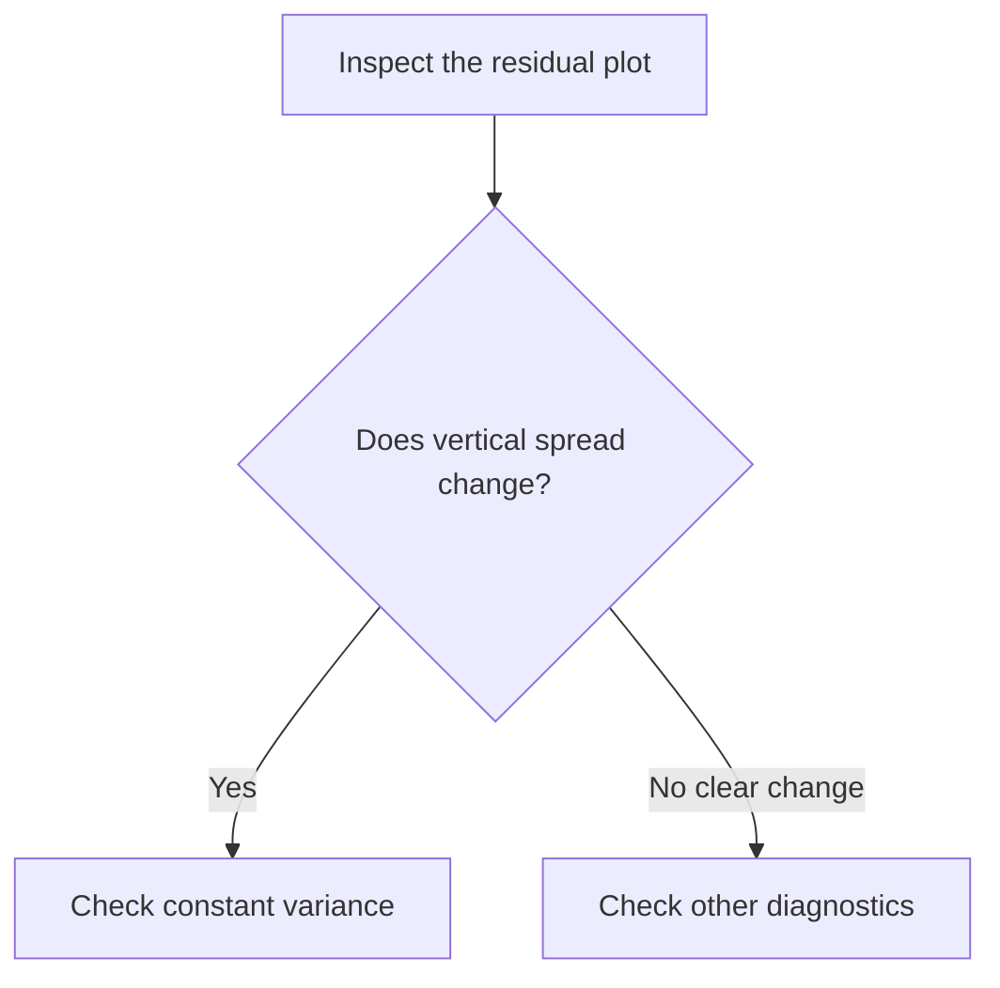

# Constant variance

在 predictor values 不同的位置，observations 围绕 conditional mean 的散布是否大致相同？

## Definition

$$
\operatorname{Var}(\varepsilon_i\mid X)=\sigma^2
\qquad \text{for every } i.
$$

这条 assumption 描述 errors 的 conditional variance。先回顾 [[Courses/DEMO101/Modules/01-Linear-Regression/01-Conditional-Mean#Mean model|conditional mean 的公式]]，再用 [[Courses/DEMO101/Modules/01-Linear-Regression/02-Residuals#Definition|residuals]] 检查样本中的形状。

![[Courses/DEMO101/Modules/01-Linear-Regression/01-Conditional-Mean#^conditional-mean]]

## Read the plot

![[Courses/DEMO101/Materials/Images/Variance-Comparison.png|620]]

在 residual plot 上比较不同 fitted values 区域的垂直散布。若出现开口逐渐变宽的漏斗形，优先复查 constant variance。沿横轴检查中心是否保持在零附近，则在问另一个问题，即 mean model 是否遗漏了系统形状。

![[Courses/DEMO101/Materials/Slides/L01-Regression-Diagnostics.pdf#page=2&height=350]]

> [!example]- Explore the interaction
> ![[Courses/DEMO101/Labs/variance/Lab#Interactive demo]]

- [[Courses/DEMO101/Labs/variance/Lab|Variance lab]] · 拖动同一个参数，观察两张图如何联动
- [[Courses/DEMO101/Practice/Worksheets/Worksheet-01#Q02|Worksheet 01 · Q02]] · 用一道题检查理解
- [[Courses/DEMO101/Materials/Sources/L01|L01 · Slides]] · 第 2 页诊断示例
- [[Courses/DEMO101/Modules/01-Linear-Regression/Module|Module outline]]
